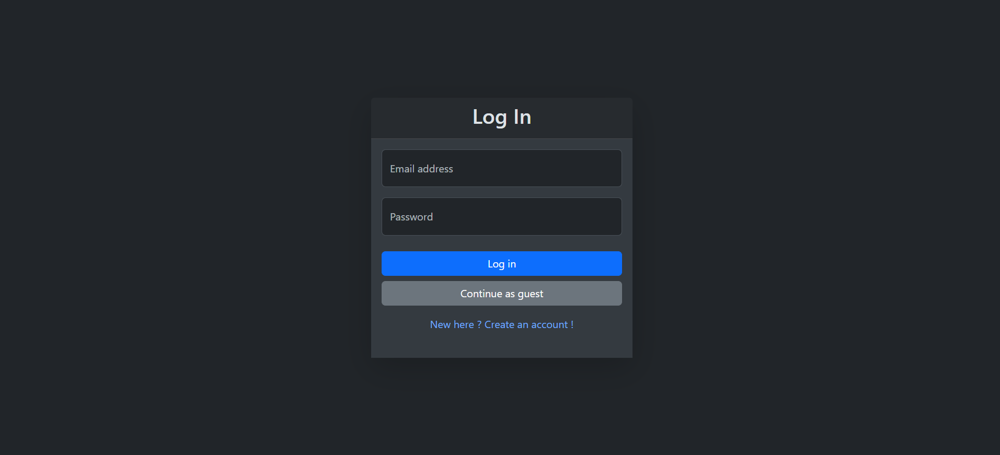
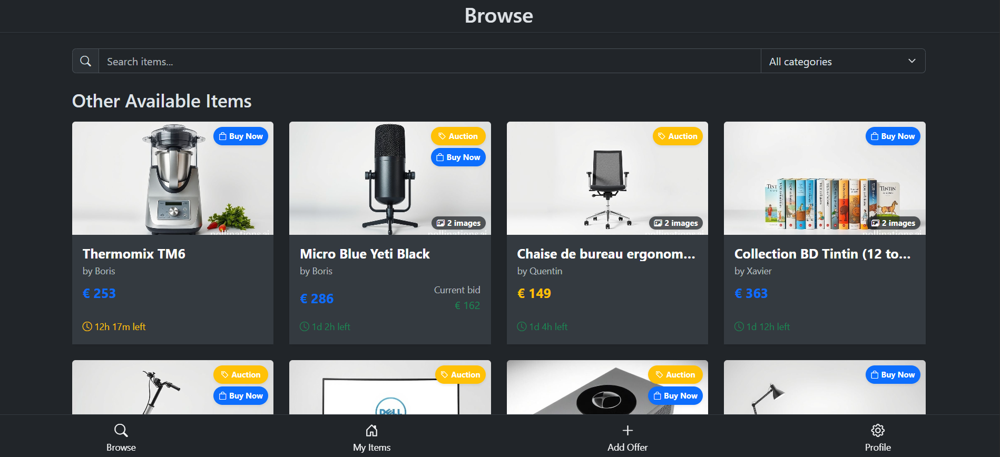
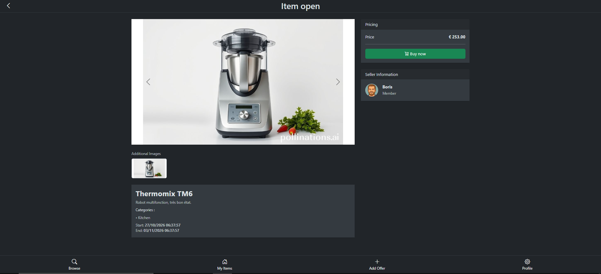
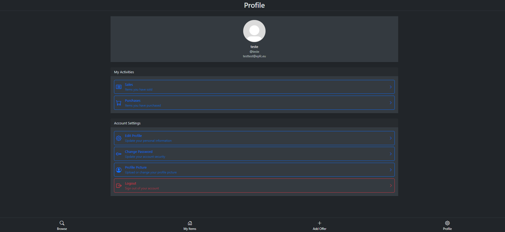
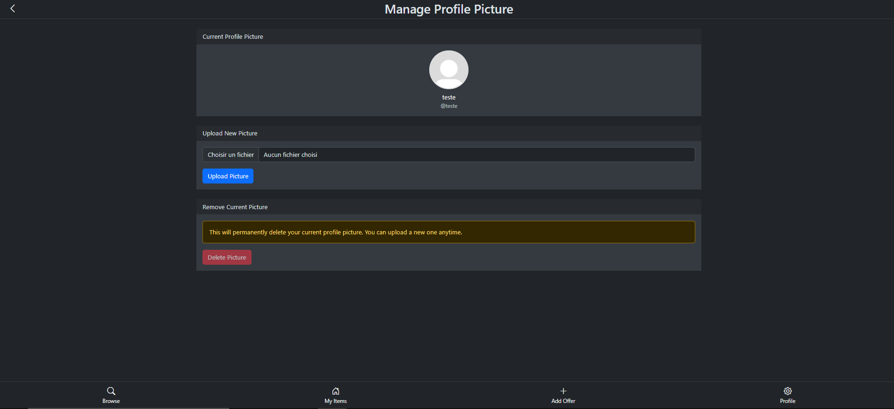
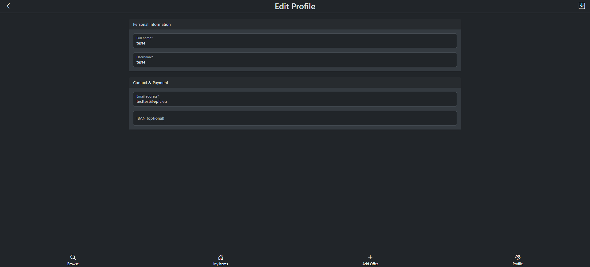
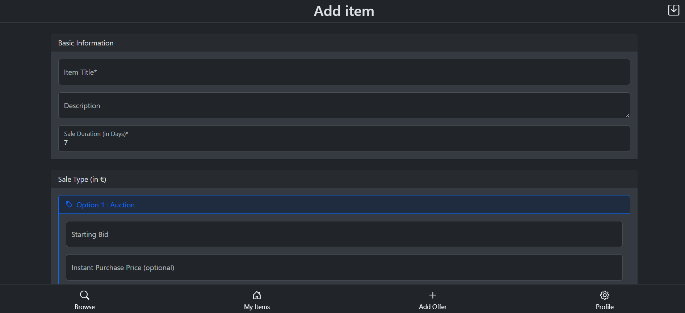
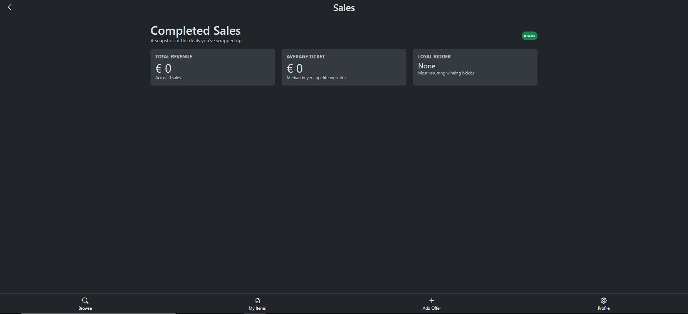

# epfcPay – Auction Platform

This is a web-based auction application developed as part of the Bachelor's degree in Application Development at **EPFC** (Brussels).

The platform allows users to list items for auction, browse available listings, and actively participate in online bidding.

> **Note:** This project was developed as a team effort using **pair programming** methodologies.

---

## Key Features

- **Listing Management:** Creation, editing, and management of auction listings.
- **Bidding System:** Browsing items and participating in real-time auctions.
- **Data Management:** Secure processing of database operations and transaction tracking.
- **Modular Architecture:** Clear separation between business logic, data management, and the user interface.

---

## Technologies Used

- **Backend:** PHP 8
- **Architecture:** MVC (Model-View-Controller)
- **Frontend:** HTML5, CSS3, Bootstrap 5, JavaScript / jQuery
- **Database:** MySQL / PostgreSQL
- **Web Server:** Apache

---

## Launching the Application

### Prerequisites

Make sure you have the following tools installed on your machine:

* [Docker Desktop](https://www.docker.com/products/docker-desktop/)

---

### Running with Docker

This method automatically installs and configures all required dependencies (Apache Web Server, PHP, MySQL, and Cron tasks).

1. **Clone the repository** (if you haven't already):
   ```bash
   git clone https://github.com/Frauenrath/epfcPay.git
2. **Go to the project folder with your terminal :**
   ```bash
   cd epfcPay
3. **Start the Docker container :**
   ```bash
   docker-compose up --build -d
4. **When started access the web site at :**
   http://localhost:8080

> **Usage Note:** To reset or re-initialize the database, navigate to: http://localhost:8080/setup/install

---

## Project Architecture

The project relies on the **MVC (Model-View-Controller)** design pattern to ensure easy maintenance and code scalability:

- **Model:** Management of business logic, SQL queries, and data persistence.
- **View:** Reactive and responsive user interface designed with Bootstrap 5.
- **Controller:** Intermediary handling user requests and synchronizing data between models and views.

---

## Screenshots

















---